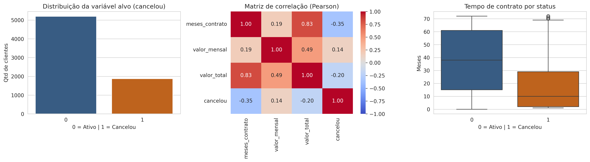
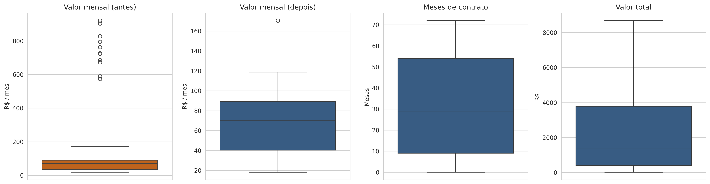
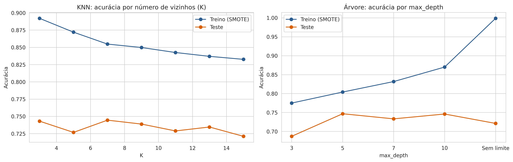
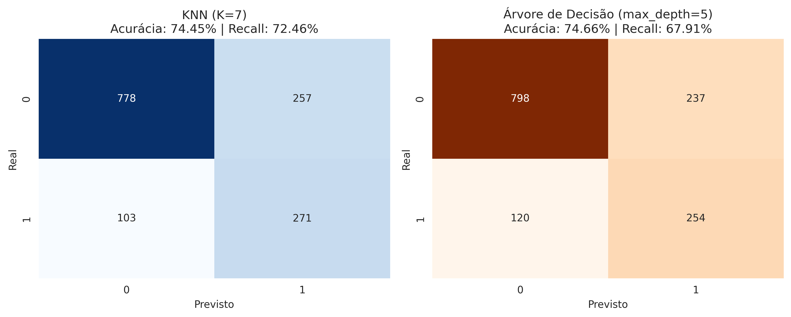

# Churn Telecom: previsão de cancelamento de clientes

Projeto de recuperação do módulo 1 de **Desenvolvimento de IA para Análise Preditiva**.
Autor: SEU NOME

Vídeo de apresentação: [assistir no Google Drive](COLE_AQUI_O_LINK_DO_VIDEO)

## O problema

Uma operadora de internet e telefonia quer descobrir com antecedência quais clientes têm mais chance de cancelar o contrato (*churn*), para que o marketing possa agir antes, com ofertas de retenção. O projeto monta um pipeline completo de ciência de dados que prevê a variável `cancelou`, que vale 1 quando o cliente encerrou o contrato e 0 quando continua ativo.

## A base de dados

A base está em `data/dataset_recuperacao_telecom.csv` e tem 7.068 linhas e 21 colunas, com dados cadastrais, serviços contratados, tempo de contrato e valores cobrados. Ela chega com problemas que precisaram de tratamento:

- 25 linhas duplicadas;
- valores ausentes em `meses_contrato`, `valor_mensal` e `valor_total`;
- 11 valores de `valor_mensal` muito acima do normal (entre R$ 573 e R$ 921), que tratei como erro de escala;
- classes desbalanceadas: cerca de 26,5% dos clientes cancelaram.

## O que o projeto faz

O notebook `analise_preditiva_churn.ipynb` segue as fases do edital:

1. **Análise exploratória:** dimensões, tipos de dados, `describe()`, distribuição do alvo, correlação de Pearson e tempo de contrato por status.
2. **Limpeza:** remoção de duplicatas, tratamento dos outliers de `valor_mensal` e imputação pela mediana, com boxplots antes e depois.
3. **Feature engineering:** criação do `gasto_medio_mensal` (`valor_total / meses_contrato`).
4. **Divisão e balanceamento:** treino e teste 80/20 com `stratify=y`, e SMOTE aplicado só no treino para evitar vazamento de dados.
5. **Escalonamento:** `StandardScaler` só nas variáveis contínuas e só para o KNN.
6. **Ajuste de parâmetros:** KNN com K de 3 a 15 e Árvore de Decisão com `max_depth` de 3 a sem limite, comparando treino e teste para achar o overfitting.
7. **Avaliação final:** acurácia e recall no teste, matrizes de confusão e escolha do modelo.

## Técnicas e tecnologias

- Python 3
- pandas e numpy, para manipulação dos dados
- matplotlib e seaborn, para os gráficos
- scikit-learn, para divisão, escalonamento, KNN, Árvore de Decisão e métricas
- imbalanced-learn, para o SMOTE
- Jupyter Notebook / Google Colab

## Resultados

Resultado no conjunto de teste (1.409 clientes):

| Modelo | Acurácia | Recall (churn) |
|---|---|---|
| Baseline (prever "ativo" para todos) | 73,46% | 0,00% |
| KNN (K=7) | 74,45% | 72,46% |
| Árvore de Decisão (`max_depth=5`) | 74,66% | 67,91% |

Pelo critério do edital, a maior acurácia, o modelo recomendado é a **Árvore de Decisão com `max_depth=5`**. A diferença para o KNN é de apenas 0,21 ponto percentual, então os dois ficaram praticamente empatados em acurácia. O KNN detectou mais cancelamentos (cerca de 17 a mais entre os 374 do teste), mas a árvore tem regras que a equipe de marketing consegue ler, e por isso foi a escolhida.

Gráficos gerados pelo notebook:






## Estrutura do repositório

```
.
├── data/
│   └── dataset_recuperacao_telecom.csv
├── outputs/
│   ├── fase1_eda_analise_inicial.png
│   ├── fase2_boxplots_outliers.png
│   ├── fase6_analise_overfitting.png
│   └── fase7_matrizes_confusao_finais.png
├── analise_preditiva_churn.ipynb
├── requirements.txt
└── README.md
```

## Como executar

**No Google Colab**

1. Faça o upload do `analise_preditiva_churn.ipynb` no Colab.
2. Abra o painel de arquivos, crie a pasta `data` e coloque nela o arquivo `dataset_recuperacao_telecom.csv`.
3. Vá em "Ambiente de execução → Reiniciar e executar tudo".

**Na sua máquina**

```bash
git clone https://github.com/SEU_USUARIO/NOME_DO_REPOSITORIO.git
cd NOME_DO_REPOSITORIO
python -m venv venv
source venv/bin/activate        # no Windows: venv\Scripts\activate
pip install -r requirements.txt
pip install notebook
jupyter notebook
```

Abra o `analise_preditiva_churn.ipynb` e execute as células em ordem. O notebook lê a base de `data/` e salva os gráficos em `outputs/`.

## Organização do Git

O desenvolvimento seguiu o fluxo com `develop` e uma feature branch para cada tarefa, abertas a partir da `develop`:

- `main`: versão final do projeto;
- `develop`: onde as features foram reunidas;
- `feature/estrutura-dados`: pastas, base de dados e `requirements.txt`;
- `feature/notebook`: o notebook com as 7 fases;
- `feature/documentacao`: este README.

As branches foram mantidas depois dos pull requests, e o código final está todo na `main`.

## Melhorias possíveis

- Escolher os parâmetros com validação cruzada ou `GridSearchCV`, em vez de olhar o conjunto de teste.
- Calcular a mediana da imputação só com o treino, dentro de um `Pipeline`, para não usar informação do teste.
- Estimar o `meses_contrato` ausente a partir de `valor_total / valor_mensal`, em vez de usar a mediana para todos.
- Testar outros modelos, como Random Forest e regressão logística, e ajustar o limiar de decisão para ganhar recall.
